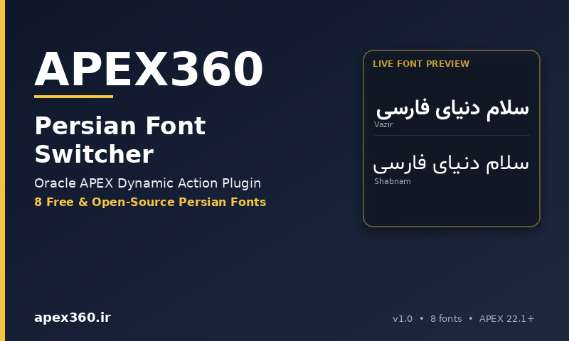
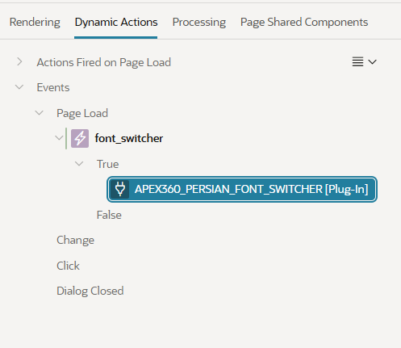
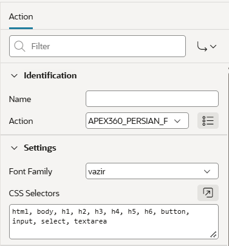

# 🎨 پلاگین تغییر فونت فارسی Oracle APEX | APEX360 Persian Font Switcher

## معرفی پلاگین

 پللاگین **APEX360 Persian Font Switcher** یک پلاگین سبک و کاربردی از نوع Dynamic Action برای Oracle APEX است که امکان تغییر فونت پیش‌فرض کل اپلیکیشن را فراهم می‌کند.

به‌جای تعریف دستی CSS و مدیریت تنظیمات فونت در صفحات مختلف، با استفاده از این پلاگین می‌توانید تنها با ایجاد یک Dynamic Action در Global Page (Page 0)، فونت موردنظر خود را در سراسر اپلیکیشن اعمال کنید.

این پلاگین شامل ۸ فونت مختلف است و به توسعه‌دهندگان اجازه می‌دهد بدون نیاز به تنظیمات تکراری CSS، ظاهر و تایپوگرافی اپلیکیشن‌های Oracle APEX خود را شخصی‌سازی کنند.

---

## ✨ امکانات پلاگین

### ۱. تغییر فونت کل اپلیکیشن

با استفاده از این پلاگین می‌توانید فونت پیش‌فرض کل اپلیکیشن Oracle APEX را تغییر دهید.

کافی است یک Dynamic Action در Global Page (Page 0) ایجاد کنید تا فونت انتخاب‌شده در تمام صفحات اپلیکیشن اعمال شود.

به این ترتیب، نیازی به تعریف جداگانه تنظیمات فونت در هر صفحه نخواهید داشت.

### ۲. پشتیبانی از ۸ فونت مختلف

این پلاگین شامل مجموعه‌ای از ۸ فونت است:

- Vazir
- Samim
- Shabnam
- Sahel
- Nahid
- Tanha
- DroidKufi
- Palatino

توسعه‌دهندگان می‌توانند به‌سادگی فونت موردنظر خود را از فهرست کشویی پلاگین انتخاب کنند.

### ۳. پیکربندی آسان

رابط کاربری پلاگین به‌گونه‌ای طراحی شده است که راه‌اندازی آن بسیار ساده باشد.

کافی است یک Dynamic Action ایجاد کنید، اکشن مربوط به پلاگین را انتخاب کنید و از طریق گزینه Font Family فونت موردنظر خود را مشخص کنید.

برای استفاده از پلاگین نیازی به نوشتن CSS اضافی نیست.

### ۴. بارگذاری بهینه CSS و فایل‌های فونت

در طراحی پلاگین تلاش شده است بارگذاری منابع غیرضروری به حداقل برسد.

پلاگین از CSS و فایل‌های فونت موردنیاز برای اعمال تنظیمات استفاده می‌کند و از بارگذاری غیرضروری منابع جلوگیری می‌کند.

---

## 🖥️ سازگاری با نسخه‌های Oracle APEX

این پلاگین برای نسخه‌های زیر قابل استفاده است:

| نسخه Oracle APEX | وضعیت پشتیبانی |
|---|---|
| 22.1 | پشتیبانی می‌شود |
| 22.2 | پشتیبانی می‌شود |
| 23.x | پشتیبانی می‌شود |
| 24.x | پشتیبانی می‌شود |
| 26.x | پشتیبانی می‌شود |

**حداقل نسخه موردنیاز:** Oracle APEX 22.1

**نوع پلاگین:** Dynamic Action Plugin

**محل پیشنهادی استفاده:** Global Page (Page 0)

---

## 📦 آموزش نصب پلاگین

### مرحله اول: دانلود پلاگین

ابتدا فایل نصب پلاگین را از لینک زیر دریافت کنید:

### مرحله دوم: نصب پلاگین در Oracle APEX

وارد محیط توسعه Oracle APEX شوید و مسیر زیر را دنبال کنید:

`Shared Components → Plug-ins → Import`

فایل SQL دانلودشده را انتخاب کنید و مراحل Import را تکمیل کنید.

### مرحله سوم: ورود به Global Page

اپلیکیشن موردنظر را در Application Builder باز کنید.

سپس وارد Page Designer شوید و صفحه زیر را انتخاب کنید:

`Page 0: Global Page`

Global Page محلی برای تعریف تنظیمات و Dynamic Actionهایی است که قرار است در سطح کل اپلیکیشن در دسترس باشند.

### مرحله چهارم: ایجاد Dynamic Action

در Page Designer:

1. بخش **Dynamic Actions** را باز کنید.
2. رویداد **Page Load** را پیدا کنید.
3. روی آن کلیک راست کرده و گزینه **Create Dynamic Action** را انتخاب کنید.

### مرحله پنجم: ایجاد True Action

در Dynamic Action ایجادشده:

1. روی بخش True Actions کلیک راست کنید.
2. گزینه **Create True Action** را انتخاب کنید.

### مرحله ششم: انتخاب پلاگین

در Property Editor مربوط به True Action، فیلد **Action** را پیدا کنید.

سپس گزینه زیر را انتخاب کنید:

`APEX360.PERSIAN_FONT_SWITCHER`

با انتخاب این گزینه، تنظیمات اختصاصی پلاگین نمایش داده خواهد شد.

### مرحله هفتم: انتخاب فونت موردنظر

در تنظیمات پلاگین، فیلدی با عنوان **Font Family** وجود دارد.

از فهرست کشویی این فیلد، فونت موردنظر خود را انتخاب کنید.

فونت‌های موجود عبارت‌اند از:

- Vazir
- Samim
- Shabnam
- Sahel
- Nahid
- Tanha
- DroidKufi
- Palatino

در نهایت تغییرات را ذخیره کرده و اپلیکیشن را اجرا کنید.

به همین سادگی! فونت انتخاب‌شده در سراسر اپلیکیشن Oracle APEX اعمال خواهد شد.

---

## ⚙️ نمونه تنظیمات پلاگین

تنظیمات پیشنهادی برای استفاده از پلاگین به شکل زیر است:

| ویژگی | مقدار |
|---|---|
| Event | Page Load |
| Action | APEX360.PERSIAN_FONT_SWITCHER |
| Font Family | فونت موردنظر شما |

### تصویر تنظیمات پلاگین

---

## 🚀 چرا از APEX360 Persian Font Switcher استفاده کنیم؟

مدیریت فونت در اپلیکیشن‌های بزرگ Oracle APEX، به‌خصوص زمانی که تعداد صفحات زیاد است، می‌تواند به یک کار تکراری تبدیل شود.

APEX360 Persian Font Switcher این فرایند را ساده‌تر می‌کند.

با استفاده از این پلاگین:

- فونت کل اپلیکیشن را از یک محل مدیریت می‌کنید.
- نیازی به تعریف CSS تکراری در صفحات مختلف ندارید.
- به ۸ فونت مختلف دسترسی خواهید داشت.
- تنظیمات فونت اپلیکیشن به‌سادگی قابل تغییر است.
- فرآیند مدیریت تایپوگرافی اپلیکیشن ساده‌تر می‌شود.
- از بارگذاری غیرضروری منابع جلوگیری می‌شود.

---

## 📄 مجوز استفاده از فونت‌ها (Font Licenses)

فونت‌های استفاده‌شده در این پلاگین تحت مجوزهای اصلی خود منتشر شده‌اند.

فونت‌های زیر تحت مجوز **SIL Open Font License** منتشر شده‌اند:

- Vazir
- Samim
- Shabnam
- Sahel
- Nahid
- Tanha

فونت **DroidKufi** نیز تحت مجوز **Apache License 2.0** منتشر شده است.

برای اطلاع از شرایط دقیق استفاده و توزیع هر فونت، به فایل مجوز اصلی همان فونت مراجعه کنید.

---

## 👨‍💻 توسعه‌دهنده

**توسعه‌دهنده: مجتبی حاجی علیقلی گیوی**

- وب‌سایت: [APEX360](https://apex360.ir)
- گیت‌هاب: [mojtabagivi](https://github.com/mojtabagivi)
- لینکدین: [Mojtaba Haji Aligholi Givi](https://www.linkedin.com/in/mojtaba-aligholi/)

---

## ⭐ حمایت و ارسال بازخورد

اگر این پلاگین برای شما مفید بوده است، با دادن یک ستاره ⭐ به مخزن GitHub از توسعه آن حمایت کنید.

نظرات، پیشنهادها و بازخوردهای شما برای بهبود نسخه‌های بعدی پلاگین ارزشمند هستند.

**APEX360 – ابزارهای کاربردی برای توسعه‌دهندگان Oracle APEX**
